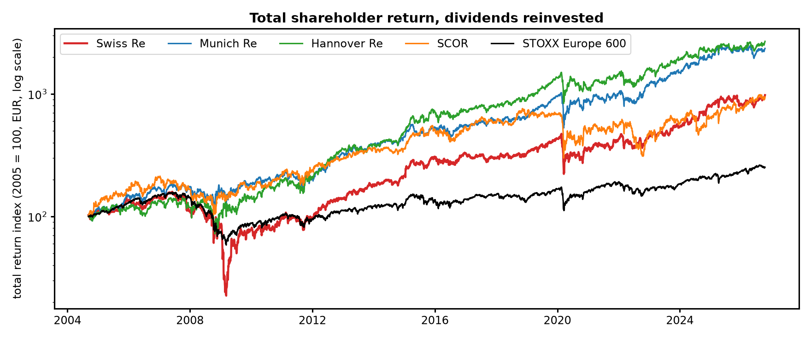

# Reinsurer Equity Analysis: Shareholder Return, Value Drivers and Catastrophe Event Study

What drives the share prices of the four large European reinsurers (Swiss Re, Munich Re, Hannover Re,
SCOR), and how do investors react to major natural catastrophes? An investor-relations style study on
22 years of public daily data (Sept 2004 – Oct 2026), all returns in EUR with dividends reinvested.



## Results (`results/summary.json`)

**1. Total shareholder return since 2004** (EUR, dividends reinvested)

| | TSR p.a. | Volatility | Max drawdown |
|---|---|---|---|
| Swiss Re | 11.2 % | 30.3 % | −86 % (Jun 2007 → Mar 2009, recovered Mar 2013) |
| Munich Re | 15.9 % | 24.4 % | −48 % (2020) |
| Hannover Re | 16.6 % | 27.6 % | −49 % (2008) |
| SCOR | 11.1 % | 31.6 % | −60 % (2020) |
| STOXX Europe 600 (price index) | 4.4 % | 17.7 % | −63 % |

Swiss Re's long-run gap to Munich Re and Hannover Re comes almost entirely from the 2007–09 crisis
(−86 %, the deepest of the four). Since 2016 the gap is smaller: Swiss Re 11.9 % p.a., Munich Re 15.3 %,
Hannover Re 13.5 %, SCOR 5.9 %, the European insurance sector ETF 11.1 %.

**2. What drives the share prices** (daily regressions, Newey–West standard errors, `fig2`, `fig3`)

| | Market beta | Return per +100 bp Bund 10y | R² |
|---|---|---|---|
| Swiss Re | 1.07 (0.05) | +1.7 % (0.7) | 0.40 |
| Munich Re | 0.95 (0.03) | +1.1 % (0.5) | 0.48 |
| Hannover Re | 0.96 (0.03) | +1.9 % (0.6) | 0.39 |
| SCOR | 0.94 (0.05) | +3.0 % (0.9) | 0.29 |

All four rise when yields rise (higher reinvestment income). The rolling 2-year sensitivity is unstable:
strongly positive in 2009–13 and 2022, briefly negative in 2020. The year-by-year attribution splits Swiss Re's
return into market, rates and stock-specific parts, and the parts add up to the total exactly. For example,
2024 (+39 % log return) was mostly stock-specific, while 2008 was mostly the market.

**3. Catastrophe event study** (15 events from Katrina 2005 to the LA wildfires 2025, market model
estimated on days −240…−21, `fig4`, `fig5`)

| Window | Mean abnormal return (60 event-stock pairs) | t |
|---|---|---|
| days −5…+5 | **−1.33 %** | **−3.2** |
| days 0…+5 | −0.67 % | −1.8 |
| days 0…+20 | −1.04 % | −1.8 |

Reinsurer shares fall around large catastrophes, and much of the move comes **before** day 0. Hurricanes are
forecast days ahead of landfall, so prices adjust in advance. The largest reactions came from Tohoku 2011
(−4.5 % on average), Ida, Irma, Harvey and Katrina (around −3 %). Christchurch 2011 and Milton 2024 had
positive average abnormal returns. No single event-stock CAR is a reliable signal on its own (see validation
below), so the evidence is in the pooled result.

## Validation

| Check | Result |
|---|---|
| OLS against `numpy.linalg.lstsq`; recovery of known betas on synthetic data | exact / within 3 s.e. (tests) |
| Attribution: market + rates + stock-specific = total, every year | max error 6 × 10⁻¹⁷ |
| Event CAR recovers an injected −6 % abnormal return (synthetic) | passes (test) |
| **Size** of the event t-test on 2,000 random non-event dates | **5.6 %** rejections (5 % nominal) |
| **Power** against an injected −3 % / −5 % abnormal return | 20 % / 47 % |
| CHF/EUR before 2005 from EUR/USD × USD/CHF vs the direct rate | 0.02 % median difference |

The size check shows that the test is well calibrated. The power check shows why single events are rarely
significant: daily idiosyncratic volatility of about 1.5 % hides a −3 % move most of the time, so conclusions
rest on the pooled 60 pairs.

**Limitations.** The STOXX Europe 600 series is a price index (without dividends), so it understates the
benchmark's total return by roughly the dividend yield. Event dates are landfall/occurrence dates; the
market model ignores rate moves during event windows. Prices come from Yahoo Finance (adjusted for
dividends and splits).

## Run

```bash
pip install -r requirements.txt
python scripts/download_data.py   # Yahoo Finance prices, ECB 10-year Bund zero rate
python -m pytest -q tests         # 6 tests
python scripts/run_study.py       # results/summary.json, results/event_*.csv, figures/
```

| File | Content |
|---|---|
| `src/reins/analysis.py` | Data loading (EUR conversion), OLS with Newey–West, TSR and drawdowns, rolling betas, attribution, event study, placebo tests |
| `scripts/run_study.py` | Full study and figures |
| `fig1_tsr` … `fig5_event_path` | TSR, yearly attribution, rolling betas, event heatmap, average event path |
